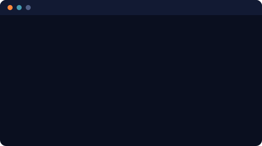

 

<table>
<tr>
<td width="48%" valign="top">

### Hakkımda

10+ yıldır Java geliştiriyorum. Dağıtık sistemler ve ölçeklenebilir altyapı kuruyorum; bunun yanında 5+ yıldır LWJGL ile OpenGL / Vulkan üzerinde gerçek zamanlı grafik yazıyorum.

- Ağ programlama, kriptografi, çok iş parçacıklı ortamlar
- JVM bytecode manipülasyonu (OW2 ASM)
- Türkiye'den çalışıyorum

</td>
<td width="52%" valign="top">

</td>
</tr>
</table>

 

  <a href="mailto:ozaiiofficial@gmail.com">Email</a> &nbsp;|&nbsp;
  <a href="https://www.ozaiidev.com.tr/">Portfolio</a> &nbsp;|&nbsp;
  <a href="https://instagram.com/yigitstack">Instagram</a> &nbsp;|&nbsp;
  <a href="https://discord.com/users/ozaii1337">Discord</a>

