<strong>English</strong> · <a href="README.tr.md">Türkçe</a> · <a href="README.zh.md">中文</a>

 

<table>
<tr>
<td width="42%" valign="top">

### About

I have been writing Java for 10+ years. I build distributed systems and scalable infrastructure, and for 5+ years I have been writing real-time graphics with LWJGL on top of OpenGL and Vulkan.

- Network programming, cryptography, multi-threaded environments
- JVM bytecode manipulation with OW2 ASM
- Based in Turkey

</td>
<td width="58%" valign="top">

</td>
</tr>
</table>

### Stack

| Area | Technologies |
|---|---|
| **Backend** | Java · Go · Python · Spring Boot · Netty |
| **Data & Infra** | PostgreSQL · MongoDB · Redis · Kafka · Docker · Kubernetes · AWS |
| **Graphics & Low-level** | LWJGL · OpenGL · Vulkan · GLSL · C/C++ · x86_64 ASM |
| **Build** | Maven · Gradle · CMake · Make |

 

  <a href="mailto:ozaiiofficial@gmail.com">Email</a> &nbsp;|&nbsp;
  <a href="https://www.ozaiidev.com.tr/">Portfolio</a> &nbsp;|&nbsp;
  <a href="https://instagram.com/yigitstack">Instagram</a> &nbsp;|&nbsp;
  <a href="https://discord.com/users/ozaii1337">Discord</a>

