<a href="README.md">English</a> · <strong>Türkçe</strong> · <a href="README.zh.md">中文</a>

 

<table>
<tr>
<td width="42%" valign="top">

### Hakkımda

10+ yıldır Java geliştiriyorum. Dağıtık sistemler ve ölçeklenebilir altyapı kuruyorum, 5+ yıldır da LWJGL ile OpenGL ve Vulkan üzerinde gerçek zamanlı grafik yazıyorum.

- Ağ programlama, kriptografi, çok iş parçacıklı ortamlar
- OW2 ASM ile JVM bytecode manipülasyonu
- Türkiye'den çalışıyorum

</td>
<td width="58%" valign="top">

</td>
</tr>
</table>

### Teknolojiler

| Alan | Teknolojiler |
|---|---|
| **Backend** | Java · Go · Python · Spring Boot · Netty |
| **Veri ve Altyapı** | PostgreSQL · MongoDB · Redis · Kafka · Docker · Kubernetes · AWS |
| **Grafik ve Düşük Seviye** | LWJGL · OpenGL · Vulkan · GLSL · C/C++ · x86_64 ASM |
| **Build** | Maven · Gradle · CMake · Make |

 

  <a href="mailto:ozaiiofficial@gmail.com">Email</a> &nbsp;|&nbsp;
  <a href="https://www.ozaiidev.com.tr/">Portfolio</a> &nbsp;|&nbsp;
  <a href="https://instagram.com/yigitstack">Instagram</a> &nbsp;|&nbsp;
  <a href="https://discord.com/users/ozaii1337">Discord</a>

