<a href="README.md">English</a> · <a href="README.tr.md">Türkçe</a> · <strong>中文</strong>

 

<table>
<tr>
<td width="42%" valign="top">

### 关于我

我写 Java 已有 10 年以上，专注于分布式系统与可扩展基础设施；同时 5 年以上使用 LWJGL，基于 OpenGL 和 Vulkan 开发实时图形程序。

- 网络编程、密码学、多线程环境
- 使用 OW2 ASM 进行 JVM 字节码操作
- 目前位于土耳其

</td>
<td width="58%" valign="top">

</td>
</tr>
</table>

### 技术栈

| 领域 | 技术 |
|---|---|
| **后端** | Java · Go · Python · Spring Boot · Netty |
| **数据与基础设施** | PostgreSQL · MongoDB · Redis · Kafka · Docker · Kubernetes · AWS |
| **图形与底层** | LWJGL · OpenGL · Vulkan · GLSL · C/C++ · x86_64 ASM |
| **构建工具** | Maven · Gradle · CMake · Make |

 

  <a href="mailto:ozaiiofficial@gmail.com">Email</a> &nbsp;|&nbsp;
  <a href="https://www.ozaiidev.com.tr/">Portfolio</a> &nbsp;|&nbsp;
  <a href="https://instagram.com/yigitstack">Instagram</a> &nbsp;|&nbsp;
  <a href="https://discord.com/users/ozaii1337">Discord</a>

